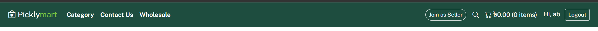
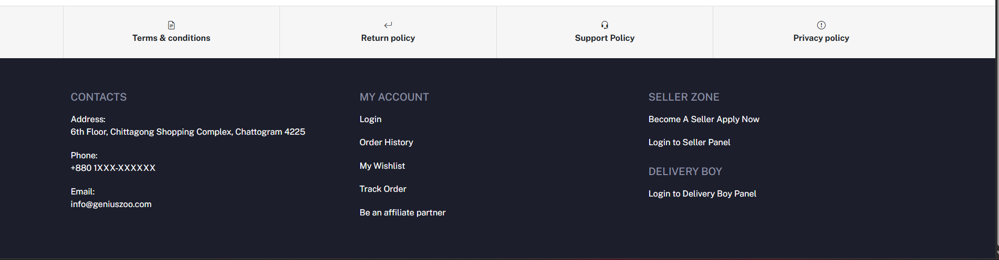
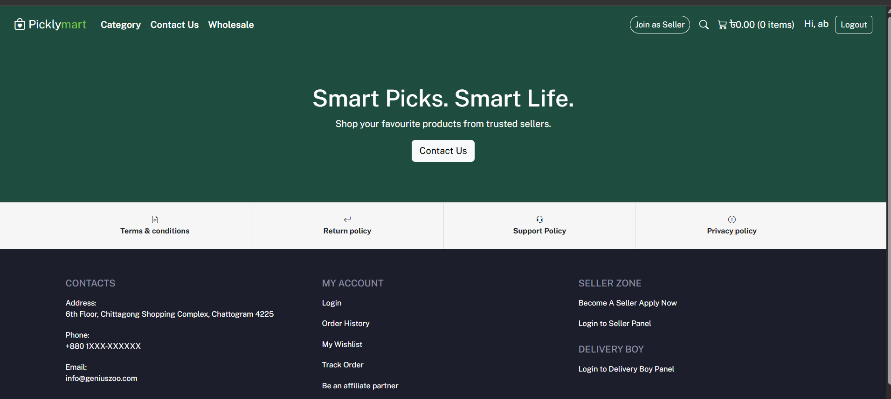
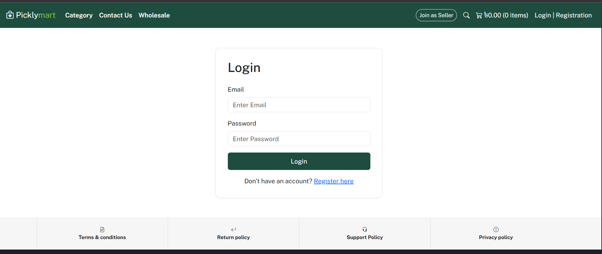
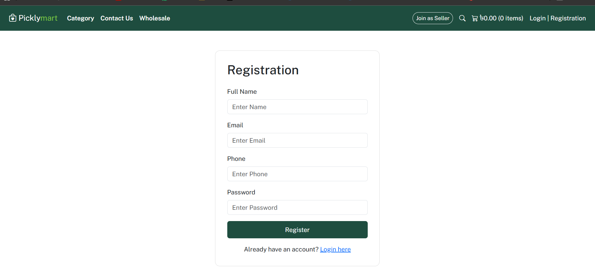
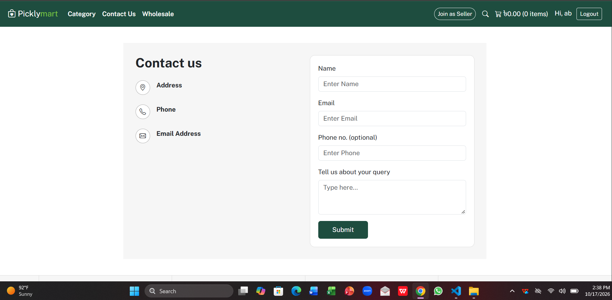

# Picklymart – Login, Registration & Contact Us

A responsive front-end website for Picklymart, built using HTML, CSS, Bootstrap, and JavaScript. This project includes a home page, user login, registration, and a contact form with a consistent navbar and footer.

## Features

- **Home Page:** Welcome banner and navigation.
- **User Registration:** Register with name, email, phone, and password.
- **User Login:** Validate credentials stored in browser localStorage.
- **Logout:** Log out of the current demo session.
- **Contact Us:** Contact information and a validated contact form.
- **Dynamic Navbar:** Displays login/register links or the logged-in user's name and logout button.
- **Reusable Components:** Loads the navbar and footer from separate HTML files.
- **Responsive Design:** Uses Bootstrap 5.3.3 for mobile and desktop layouts.
- **Form Validation:** Uses HTML and Bootstrap validation.

## Technologies Used

- HTML5
- CSS3
- Bootstrap 5.3.3
- Bootstrap Icons
- JavaScript
- Browser localStorage

## Project Structure

```text
Picklymart_intern_project/
├── index.html
├── login.html
├── register.html
├── contact-us.html
├── navbar.html
├── footer.html
├── style.css
├── js/
│   └── script.js
├── screenshots/
│   ├── home.png
│   ├── login.png
│   ├── registration.png
│   └── contact-us.png
│   └── navbar.png
│   └── footer.png
└── README.md
```

## How to Run the Project

1. Clone or download this repository.
2. Open the project folder in Visual Studio Code.
3. Install the **Live Server** extension if you do not already have it.
4. Right-click `index.html` and select **Open with Live Server**.
5. Register a demo account, then log in to explore the website.

**Important:** Run the project through Live Server or another local HTTP server because the navbar and footer are loaded using JavaScript `fetch()`.

## Screenshots


### NavBar Section



### Footer Section



### Home Page



### Login Page



### Registration Page



### Contact Us Page



## Demo Authentication Notice

This is a front-end demonstration project. User information is stored in browser `localStorage`. Passwords are not securely hashed, and this implementation is not suitable for production authentication.

The contact form displays a success message but does not send messages to a server.

## Future Improvements

- Add a backend API and database.
- Implement secure password hashing and authentication.
- Add email verification and password recovery.
- Connect the contact form to a backend service.

## Author

**Absar Uddin**

- GitHub: [@absaruddins](https://github.com/absaruddins)
- LinkedIn: [@absaruddins](https://www.linkedin.com/in/absaruddins/)

---

*Built as a front-end web development project.*
